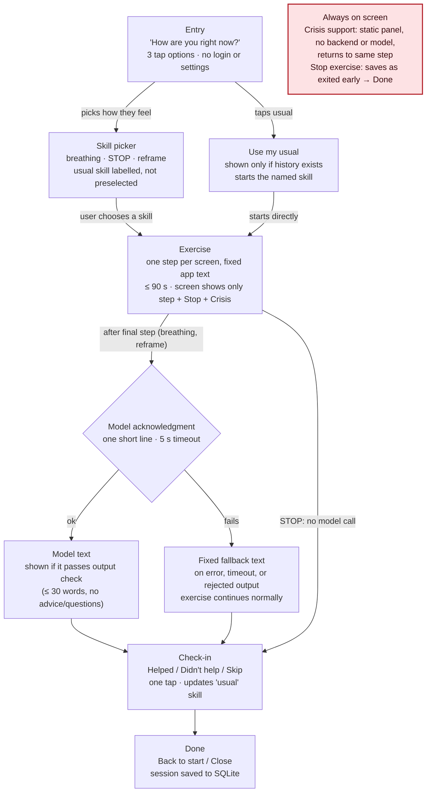

# Design — Mental Health Skills Prototype (Part 3.1)

> Coursework prototype. Not therapy, not diagnosis, not monitoring, not for real crisis use. Findings codes (R1–R4, D1–D6) refer to Assignment 3 overview (Canvas), Section 3.

## a. Overview & scope

The app guides one short skill at a time on localhost (Vue + FastAPI + SQLite).

| Skill | Built in | Model contribution |
|---|---|---|
| Paced breathing (4-in / 6-out) | Part 3.2 (core) | One short closing acknowledgment |
| STOP | Part 3.3 | None planned (fixed text) |
| One-minute cognitive reframe | Part 3.3 | Short reflection of the user's alternative thought |

5-4-3-2-1 grounding is out of scope (see section j).

The **app** controls each skill's sequence, timers, exits, saved state, and crisis access. The **model** only writes short, neutral acknowledgments.

The app **cannot detect distress**. It knows only what the user taps or types, and their past sessions.

## b. User flow



**Stop exercise and Crisis support are available on every screen. Stop exercise saves the session as exited early and goes to Done. Crisis support opens a static panel (no backend or model) and returns to the same step.**

Notes:

- The Crisis support button opens the panel from **every** screen. "Back" returns to the same step. The exercise is paused, not ended.
- Stop exercise is available on every exercise step. The session is saved as `exited_early` and the user goes to Done, with no check-in. If saving fails, the user still moves on.
- History is reachable from a small link on the entry screen only. It is not shown inside exercises.

## c. Screens

**Shared frame inside an exercise (D1, D4).** Each exercise screen shows only:

- the step
- **Stop exercise** (top left)
- **Crisis support** (fixed, top right)

There is no navigation, history link, or progress bar of steps. This contraction is a **fixed design choice** that applies to everyone. It is not triggered by anything the app infers.

### Entry (all skills)

- Prompt: "How are you right now?"
- Options: **"Tense or wound up"** · **"Overwhelmed"** · **"Okay, just want a minute"**
- If history exists, a "**Use my usual: Paced breathing**" button. It names the skill, so the user knows what will start.
- Footer: "Coursework prototype. Not a support service."
- No login and no settings.

### Paced breathing (Part 3.2)

| # | Screen | Text / behavior |
|---|---|---|
| 1 | Intro (~5 s) | "Breathe in as the circle grows, out as it shrinks. Seven slow breaths." The first cycle starts automatically after 5 s, or earlier if the user taps "Start". |
| 2 | Breathing (70 s) | A muted circle grows for 4 s with the label "In", then shrinks for 6 s with the label "Out". Seven cycles. Easing is slow, and nothing flashes. A low-contrast "3 of 7" sits under the circle (see section k). |
| 3 | Closing | Model acknowledgment, or the fallback: "That was seven slow breaths." Then a "Continue" button. The request is sent at the start of cycle 7, so it usually arrives before the user reaches this screen. |

This is one action per screen. The breathing screen is a single action: follow the circle.

### STOP (Part 3.3)

Each screen advances when the user taps "Next". There is no auto-advance.

| # | Text |
|---|---|
| 1 | "**Stop.** Pause what you're doing for a moment." |
| 2 | "**Take a step back.** Let yourself take one slow breath." |
| 3 | "**Observe.** Notice what is happening inside you and around you. No need to write anything." |
| 4 | "**Proceed mindfully.** Choose what you'll do next." |

There is no model call. The final step is the end of the exercise.

### One-minute cognitive reframe (Part 3.3)

Each step has a short text field and optional quick-select chips. The user can tap "Next" with the field empty.

| # | Prompt | Chips |
|---|---|---|
| 1 | "What's the thought?" | "Something will go wrong" · "I messed up" · "I'd rather not say" |
| 2 | "What supports that thought?" | "Something that happened" · "A feeling more than a fact" · "Not sure" |
| 3 | "Is there another way to see it?" | "It may not be as certain as it feels" · "I've got through hard moments before" · "Not sure yet" |
| 4 | Reflection | The model briefly reflects the step-3 answer back, e.g. "Another way to see it: it may not be as certain as it feels." Fallback: "You've noted another way to look at it." |

Before any text is sent, the keyword check (section f) runs on it in the frontend.

### Check-in, Done, History

- **Check-in:** "Did this help?" Options: **Helped** · **Didn't help** · **Skip**. One tap. Skip saves no rating.
- **Done:** "Done." Buttons: "Back to start" and "Close". After a stop: "Stopped. That's fine." Same buttons.
- **History:** a list of date · skill · "Finished" or "Stopped early". Typed text is not shown (section g).

## d. Timing budget

The rule: guided exercise ≤ 90 s at intended pace, measured from the first instruction to the final planned step, app delays included. Entry and setup are reported separately. User-chosen pauses and crisis-panel time are excluded. No timer forces an exit.

| Skill | Steps | Assumptions | Guided time |
|---|---|---|---|
| Paced breathing | Intro 5 s + 7 × (4 s in + 6 s out) + closing | Intro is read in ~5 s. The model call is prefetched during cycle 7, so it adds 0–5 s. | **75 s** typical, **80 s** worst case (5 s timeout) |
| STOP | 4 screens | ~15 s per screen to read and tap Next | **~60 s** |
| Reframe | 3 input steps + reflection | 20–25 s per step with chips or a short typed phrase. Model latency ≤ 5 s (timeout). ~5 s to read the reflection. | **~70 s** typical (3×20 + 2 + 5), **85 s** worst case (3×25 + 5 + 5) |

Entry and setup, reported separately: entry choice ~5–10 s, skill pick ~3–5 s. "Use my usual" skips the picker.

These figures are planned estimates. Part 3.2 will measure breathing from timestamps in `sessions`/`messages`. The reframe's 20–25 s per step is the weakest assumption, because a user typing a longer thought could exceed it. That is user pace, not app delay, and it is never cut off.

## e. Model role, prompt boundaries, failure handling

**Role.** The model produces one short, calm, non-judgmental acknowledgment. It does nothing else.

| Use | Built in | Context sent | Example output shape |
|---|---|---|---|
| Breathing close | 3.2 | skill, entry choice, completed (true), count of earlier completed breathing sessions | "You came in feeling tense and took seven slow breaths." |
| Reframe reflection | 3.3 | the user's step-3 text only | "Another way to see it: it may not be as certain as it feels." |

**The prompt allows:** one or two sentences, ≤ 30 words, plain neutral tone, and reflecting or acknowledging only.

**The prompt forbids:** advice, instructions, new exercise steps, questions to the user, diagnoses or clinical terms, therapy claims, praise or cheerleading, exclamation marks, and claims to remember the user or watch over them.

**The app enforces these limits.** The prompt alone is not trusted. `model_client.py` rejects any output that:

- is over 30 words
- contains a question mark or an exclamation mark
- contains a word from a short banned list (e.g. "diagnos", "disorder", "therapy", "you should", "you must")

A rejected output is replaced with the fixed fallback.

**Failure handling.**

- Every call uses a 5 s timeout.
- Network error, non-2xx status, timeout, empty output, or rejected output → fixed fallback text. The exercise continues.
- The fallback text is shown the same way as model text, and the source is logged in `messages.role` (`model` vs `fallback`).
- No model call is made after Stop exercise, or for text that matched the crisis keyword check.
- The crisis panel never waits on a model or backend call.

## f. Crisis access and keyword detection limits

**Primary mechanism.** A **Crisis support** button is fixed on every screen and opens `CrisisPanel.vue`. This is a static frontend component with its content bundled in the app. It makes no `fetch` and no model call, so it works with the backend or model down. The panel contains:

- **988 Suicide & Crisis Lifeline**: call or text 988 (`tel:988`, `sms:988`)
- **Crisis Text Line**: text HOME to 741741 (`sms:741741?&body=HOME`)
- **911** for emergencies (`tel:911`)
- "This app is a coursework prototype and can't help in a crisis."
- **Back to where I was**

**Supplementary keyword check.** This runs in the frontend on typed reframe text before the text is sent. A match against a short phrase list (e.g. "kill myself", "suicide", "end it all", "hurt myself", "want to die") opens the crisis panel over the current step. That text is not sent to the model. The user can go back and continue or stop.

Limitations, stated plainly:

- **Misses** misspellings, indirect phrasing ("I don't see the point anymore"), other languages, and anything said rather than typed. Breathing and STOP take no typed input, so the check never runs there.
- **False positives**: quoting or idioms (e.g. "end it all" said about a project) open the panel when nothing is wrong. The cost is low, because one tap goes back.
- It is not a classifier and not distress detection, and the app does not claim it is. **The system prompt is not a safety mechanism either.** The always-visible button is the safety route.

## g. Data model (SQLite)

```
sessions(id INTEGER PK, skill TEXT, started_at TEXT, ended_at TEXT,
         completed INTEGER, exited_early INTEGER, entry_choice TEXT)
messages(id INTEGER PK, session_id INTEGER FK, role TEXT, text TEXT, created_at TEXT)
         -- role: 'user' (reframe input) | 'model' | 'fallback'
feedback(id INTEGER PK, session_id INTEGER FK, rating TEXT)
         -- rating: 'helped' | 'didnt_help'; Skip = no row
```

- **Shown back to the user:** a history list of date, skill, and Finished / Stopped early. The usual skill also appears on the entry button.
- **Stored but not shown by default:** typed reframe text and the model/fallback text, in `messages`. Whether to show these is an open question (section k).
- **Not stored:** names, accounts, emails, IP or device identifiers, crisis-panel opens, and the matched crisis keyword. Text that triggered the keyword check is not saved. Fixed step text is not copied into `messages`.
- **Not sent to the model:** history beyond the single count listed in section e, and any reframe text except the step-3 answer.

## h. Personalization vs. user control

**Mechanism.** The "usual skill" is derived from history with no configuration (D5):

1. the skill of the most recent session rated **Helped**
2. otherwise, the skill with the most completed sessions (ties go to the most recent)
3. otherwise, there is no usual and no button

The app uses the usual skill in two places: the "Use my usual" button on entry, and a "Your usual" label in the picker. It never auto-starts a skill (R4).

| Gain | Give up |
|---|---|
| A returning user can start in one tap and skip the picker (D3, D5) | Precision. "Most recent Helped" is a crude signal, and one rating can flip the usual. |
| No forms or settings screen to fill in (D5) | Explicit preferences. The user can't say "never suggest reframe". |
| The user still chooses every time. The suggestion is visible and ignorable (R4). | Some speed. Each session still needs one tap to start. |
| The entry choice is recorded for context | It isn't used to route. The app can't know whether "Overwhelmed" should mean breathing. |

**Correcting the app.** The user ignores the suggestion and picks another skill, or rates sessions. The next derivation reflects that. There is nothing hidden to undo.

## i. Requirement / design-principle mapping

| Decision | Finding | Rationale |
|---|---|---|
| Each guided exercise ≤ 90 s (75 / 60 / ~70–85 s) | R1 | Attention dropped past 90–100 s, and ~60 s felt comfortable |
| Breathing uses 7 cycles, not more | R1 | Keeps the core skill near the comfortable ~60–75 s range |
| Fixed Crisis support button on every screen, static component | R2, D4 | Safety must be reachable without navigating. Participants noticed when it disappeared inside an exercise. |
| Crisis panel works without backend or model | R2 | It stays frictionless even when something fails |
| Stop exercise always visible, no confirmation, neutral wording, saved as `exited_early` | R3 | Participants needed leaving to cost nothing |
| Done screen after a stop says "Stopped. That's fine." | R3, D6 | No guilt or consequence language |
| User picks the skill. Suggestions are labels only, never auto-start. | R4 | Participants wanted options, not routing |
| Entry asks "How are you right now?" with 2–3 options | R4, D3 | Supports choosing by emotional state with one low-effort tap |
| UI contracts inside an exercise (step + Stop + Crisis only) | D1 | Less interface during the exercise. The contraction is manual and fixed, because D1 does not establish how to detect distress. |
| One step per screen; steps come from the app | D2 | Participants responded to exactly one action per screen |
| Chips, optional empty input, no disclosure required in STOP "Observe" | D3 | Reduces demands to feel, disclose, or perform |
| Check-in is one tap and skippable | D3, D5 | Lightweight feedback with no required input |
| "Use my usual" derived from history, no settings | D5 | Adapts from past use without configuration burden |
| Muted low-saturation palette, slow circle, no flashing | D6 | Saturated colour and motion read as demand |
| Neutral wording: not clinical, not cheerful; model output filtered | D6 | Clinical phrasing read as diagnosis, cheerful phrasing as condescension |
| Model limited to short acknowledgments, 5 s timeout, fixed fallback | D2, D6, R2 | Keeps the sequence predictable, the tone controlled, and exercises unaffected by model failure |

## j. Alternatives considered and rejected

| Alternative | Rejected because |
|---|---|
| Automatic skill routing from the entry answer or history | **R4**: participants wanted to be offered options, not routed. It would also rely on inference the app can't justify (D1). |
| Chat-first interface (user talks, model guides) | **D2**: no clear single action per screen. **D3**: demands typing and disclosure. It would also hand the step sequence to the model. |
| Skill library / dashboard home | **D2**: participants explicitly did not want a library, menu, or dashboard. |
| Preferences setup screen (favourite skill, tone, etc.) | **D5**: configuration burden. History gives the same benefit for free. |
| Confirmation dialog on Stop ("Are you sure?") | **R3**: leaving must cost nothing. |
| Sentiment/distress classifier to trigger crisis or contraction | **D1**: no reliable detection is established. It would also add a model dependency to safety (R2). |
| 5-4-3-2-1 grounding as a fourth skill | **D3**: as specified it asks for 15 items of input. Deferred, not ruled out. |

## k. Open questions

1. Should history show the user's own typed reframe text? (Default: no. Shown only on a deliberate tap? Never?)
2. Should the entry choice influence which skill is labelled as suggested, or should only history do that?
3. Entry option wording: are "Tense or wound up / Overwhelmed / Okay, just want a minute" neutral enough (D6)?
4. Does the "3 of 7" breathing counter help people know when it ends, or add demand (D3, D6)?
5. Does the model's breathing acknowledgment add anything over the fixed fallback? To be evaluated in 3.2 with mocked and live calls.
6. Should the user be able to clear history? This is a control, not configuration, but it adds a screen.
7. Should crisis-panel opens be counted (with no content) to support the evaluation, or left unrecorded as now?
8. Is 5 s the right model timeout for the chosen provider? To be measured in 3.2.
9. Crisis resources are US-only. Is that acceptable for a localhost coursework prototype? Note it in the README.
10. After Stop exercise, should the user go to Done (current) or straight back to entry?
