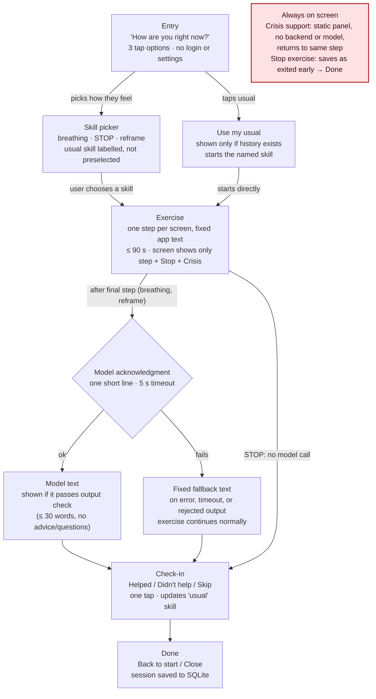

# Design — Mental Health Skills Prototype

> Coursework prototype. Not therapy, not diagnosis, not monitoring, not for real crisis use. Findings codes (R1–R4, D1–D6) refer to Assignment 3 overview (Canvas), Section 3.

> **How to read this document.** Sections a–j are the Part 3.1 design, kept as written so the original reasoning stays visible. **Section l lists every place the finished app differs, and the finding behind each change.** Where they disagree, section l wins. Section k closes every open question. The evaluation is in [evaluation.md](evaluation.md).

## a. Overview & scope

The app guides one short skill at a time on localhost (Vue + FastAPI + SQLite).

| Skill | Built in | Model contribution |
|---|---|---|
| Paced breathing (4-in / 6-out) | Part 3.2 (core) | One short closing acknowledgment |
| STOP | Part 3.3 | None planned (fixed text) |
| One-minute cognitive reframe | Part 3.3 | Short reflection of the user's alternative thought |

5-4-3-2-1 grounding is out of scope because it asks for 15 items of input (D3).

The **app** controls each skill's sequence, timers, exits, saved state, and crisis access. The **model** only writes short, neutral acknowledgments.

The app **cannot detect distress**. It knows only what the user taps or types, and their past sessions.

## b. User flow



**Stop exercise and Crisis support are available on every screen. Stop exercise saves the session as exited early and goes to Done. Crisis support opens a static panel (no backend or model) and returns to the same step.**

Notes:

- The Crisis support button opens the panel from **every** screen. "Back" returns to the same step. The exercise is paused, not ended.
- Stop exercise is available on every exercise step. The session is saved as `exited_early` and the user goes to Done, with no check-in. If saving fails, the user still moves on.
- History is reachable from a small link on the entry screen only. It is not shown inside exercises.

## c. Screens

**Shared exercise frame (D1, D4).** Each exercise screen shows only the step, **Stop exercise** (top left), and **Crisis support** (fixed, top right). There is no navigation, history link, or progress bar of steps. This contraction is fixed for everyone and is not triggered by anything the app infers.

### Entry (all skills)

- Prompt: "How are you right now?"
- Options: **"Tense or wound up"** · **"Overwhelmed"** · **"Okay, just want a minute"**
- If history exists: "**Use my usual: Paced breathing**" (names the skill that will start).
- Footer: "Coursework prototype. Not a support service." No login and no settings.

### Paced breathing (Part 3.2)

| # | Screen | Text |
|---|---|---|
| 1 | Intro | "Breathe in as the circle grows, out as it shrinks. Seven slow breaths." Starts after 5 s, or on "Start". |
| 2 | Breathing | Muted circle labelled "In" (grows) and "Out" (shrinks). Low-contrast "3 of 7" counter. Slow easing, nothing flashes. |
| 3 | Closing | Model acknowledgment, or fallback: "That was seven slow breaths." Button: "Continue". |

### STOP (Part 3.3)

Each screen advances on "Next". There is no auto-advance.

| # | Text |
|---|---|
| 1 | "**Stop.** Pause what you're doing for a moment." |
| 2 | "**Take a step back.** Let yourself take one slow breath." |
| 3 | "**Observe.** Notice what is happening inside you and around you. No need to write anything." |
| 4 | "**Proceed mindfully.** Choose what you'll do next." |

### One-minute cognitive reframe (Part 3.3)

Each step has a short text field and optional chips. "Next" works with the field empty.

| # | Prompt | Chips |
|---|---|---|
| 1 | "What's the thought?" | "Something will go wrong" · "I messed up" · "I'd rather not say" |
| 2 | "What supports that thought?" | "Something that happened" · "A feeling more than a fact" · "Not sure" |
| 3 | "Is there another way to see it?" | "It may not be as certain as it feels" · "I've got through hard moments before" · "Not sure yet" |
| 4 | Reflection | Model example: "Another way to see it: it may not be as certain as it feels." Fallback: "You've noted another way to look at it." |

### Check-in, Done, History

- **Check-in:** "Did this help?" Options: **Helped** · **Didn't help** · **Skip**. One tap. Skip saves no rating.
- **Done:** "Done." Buttons: "Back to start" and "Close". After a stop: "Stopped. That's fine." Same buttons.
- **History:** a list of date · skill · "Finished" or "Stopped early". Typed text is not shown (section g).

## d. Timing budget

The rule: guided exercise ≤ 90 s at intended pace, measured from the first instruction to the final planned step, app delays included. Entry and setup are reported separately. User-chosen pauses and crisis-panel time are excluded. No timer forces an exit.

| Skill | Steps | Assumptions | Guided time |
|---|---|---|---|
| Paced breathing | Intro 5 s + 7 × (4 s in + 6 s out) + closing | Intro is read in ~5 s. The model call is prefetched during cycle 7, so it adds 0–5 s. | **75 s** typical, **80 s** worst case (5 s timeout) |
| STOP | 4 screens | ~15 s per screen to read and tap Next | **~60 s** |
| Reframe | 3 input steps + reflection | 20–25 s per step with chips or a short typed phrase. Model latency ≤ 5 s (timeout). ~5 s to read the reflection. | **~70 s** typical (3×20 + 2 + 5), **85 s** worst case (3×25 + 5 + 5) |

Entry and setup, reported separately: entry choice ~5–10 s, skill pick ~3–5 s. "Use my usual" skips the picker.

These figures are planned estimates. Part 3.2 will measure breathing from timestamps in `sessions`/`messages`. The reframe's 20–25 s per step is the weakest assumption, because a user typing a longer thought could exceed it. That is user pace, not app delay, and it is never cut off.

## e. Model role, prompt boundaries, failure handling

**Role.** The model produces one short, calm, non-judgmental acknowledgment. It does nothing else.

| Use | Built in | Context sent | Example output shape |
|---|---|---|---|
| Breathing close | 3.2 | skill, entry choice, completed (true), count of earlier completed breathing sessions | "You came in feeling tense and took seven slow breaths." |
| Reframe reflection | 3.3 | the user's step-3 text only | "Another way to see it: it may not be as certain as it feels." |

**The prompt allows:** one or two sentences, ≤ 30 words, plain neutral tone, and reflecting or acknowledging only.

**The prompt forbids:** advice, instructions, new exercise steps, questions to the user, diagnoses or clinical terms, therapy claims, praise or cheerleading, exclamation marks, and claims to remember the user or watch over them.

**The app enforces these limits.** The prompt alone is not trusted. `model_client.py` rejects any output that:

- is over 30 words
- contains a question mark or an exclamation mark
- contains a word from a short banned list (e.g. "diagnos", "disorder", "therapy", "you should", "you must")

A rejected output is replaced with the fixed fallback.

**Failure handling.**

- Every call uses a 5 s timeout.
- Network error, non-2xx status, timeout, empty output, or rejected output → fixed fallback text. The exercise continues.
- The fallback text is shown the same way as model text, and the source is logged in `messages.role` (`model` vs `fallback`).
- No model call is made after Stop exercise, or for text that matched the crisis keyword check.
- The crisis panel never waits on a model or backend call.

## f. Crisis access and keyword detection limits

**Primary mechanism.** A **Crisis support** button is fixed on every screen and opens `CrisisPanel.vue`. This is a static frontend component with its content bundled in the app. It makes no `fetch` and no model call, so it works with the backend or model down. The panel contains:

- **988 Suicide & Crisis Lifeline**: call or text 988 (`tel:988`, `sms:988`)
- **Crisis Text Line**: text HOME to 741741 (`sms:741741?&body=HOME`)
- **911** for emergencies (`tel:911`)
- "This app is a coursework prototype and can't help in a crisis."
- **Back to where I was**

**Supplementary keyword check.** This runs in the frontend on typed reframe text before the text is sent. A match against a short phrase list (e.g. "kill myself", "suicide", "end it all", "hurt myself", "want to die") opens the crisis panel over the current step. That text is not sent to the model. The user can go back and continue or stop.

Limitations, stated plainly:

- **Misses** misspellings, indirect phrasing ("I don't see the point anymore"), other languages, and anything said rather than typed. Breathing and STOP take no typed input, so the check never runs there.
- **False positives**: quoting or idioms (e.g. "end it all" said about a project) open the panel when nothing is wrong. The cost is low, because one tap goes back.
- It is not a classifier and not distress detection, and the app does not claim it is. **The system prompt is not a safety mechanism either.** The always-visible button is the safety route.

## g. Data model (SQLite)

```
sessions(id INTEGER PK, skill TEXT, started_at TEXT, ended_at TEXT,
         completed INTEGER, exited_early INTEGER, entry_choice TEXT)
messages(id INTEGER PK, session_id INTEGER FK, role TEXT, text TEXT, created_at TEXT)
         -- role: 'user' (reframe input) | 'model' | 'fallback'
feedback(id INTEGER PK, session_id INTEGER FK, rating TEXT)
         -- rating: 'helped' | 'didnt_help'; Skip = no row
```

- **Shown back to the user:** a history list of date, skill, and Finished / Stopped early. The usual skill also appears on the entry button.
- **Stored but not shown by default:** typed reframe text and the model/fallback text, in `messages`. Whether to show these is an open question (section k).
- **Not stored:** names, accounts, emails, IP or device identifiers, crisis-panel opens, and the matched crisis keyword. Text that triggered the keyword check is not saved. Fixed step text is not copied into `messages`.
- **Not sent to the model:** history beyond the single count listed in section e, and any reframe text except the step-3 answer.

## h. Personalization vs. user control

**Mechanism.** The "usual skill" is derived from history with no configuration (D5):

1. the skill of the most recent session rated **Helped**
2. otherwise, the skill with the most completed sessions (ties go to the most recent)
3. otherwise, there is no usual and no button

The app uses the usual skill in two places: the "Use my usual" button on entry, and a "Your usual" label in the picker. It never auto-starts a skill (R4).

| Gain | Give up |
|---|---|
| A returning user can start in one tap and skip the picker (D3, D5) | Precision. "Most recent Helped" is a crude signal, and one rating can flip the usual. |
| No forms or settings screen to fill in (D5) | Explicit preferences. The user can't say "never suggest reframe". |
| The user still chooses every time. The suggestion is visible and ignorable (R4). | Some speed. Each session still needs one tap to start. |
| The entry choice is recorded for context | It isn't used to route. The app can't know whether "Overwhelmed" should mean breathing. |

**Correcting the app.** The user ignores the suggestion and picks another skill, or rates sessions. The next derivation reflects that. There is nothing hidden to undo.

## i. Requirement / design-principle mapping

| Decision | Finding | Rationale |
|---|---|---|
| Each guided exercise ≤ 90 s (75 / 60 / ~70–85 s) | R1 | Attention dropped past 90–100 s, and ~60 s felt comfortable |
| Breathing uses 7 cycles, not more | R1 | Keeps the core skill near the comfortable ~60–75 s range |
| Fixed Crisis support button on every screen, static component | R2, D4 | Safety must be reachable without navigating. Participants noticed when it disappeared inside an exercise. |
| Crisis panel works without backend or model | R2 | It stays frictionless even when something fails |
| Stop exercise always visible, no confirmation, neutral wording, saved as `exited_early` | R3 | Participants needed leaving to cost nothing |
| Done screen after a stop says "Stopped. That's fine." | R3, D6 | No guilt or consequence language |
| User picks the skill. Suggestions are labels only, never auto-start. | R4 | Participants wanted options, not routing |
| Entry asks "How are you right now?" with 2–3 options | R4, D3 | Supports choosing by emotional state with one low-effort tap |
| UI contracts inside an exercise (step + Stop + Crisis only) | D1 | Less interface during the exercise. The contraction is manual and fixed, because D1 does not establish how to detect distress. |
| One step per screen; steps come from the app | D2 | Participants responded to exactly one action per screen |
| Chips, optional empty input, no disclosure required in STOP "Observe" | D3 | Reduces demands to feel, disclose, or perform |
| Check-in is one tap and skippable | D3, D5 | Lightweight feedback with no required input |
| "Use my usual" derived from history, no settings | D5 | Adapts from past use without configuration burden |
| Muted low-saturation palette, slow circle, no flashing | D6 | Saturated colour and motion read as demand |
| Neutral wording: not clinical, not cheerful; model output filtered | D6 | Clinical phrasing read as diagnosis, cheerful phrasing as condescension |
| Model limited to short acknowledgments, 5 s timeout, fixed fallback | D2, D6, R2 | Keeps the sequence predictable, the tone controlled, and exercises unaffected by model failure |

## j. Alternatives considered and rejected

| Alternative | Rejected because |
|---|---|
| Automatic skill routing from the entry answer or history | **R4**: participants wanted to be offered options, not routed. It would also rely on inference the app can't justify (D1). |
| Chat-first interface (user talks, model guides) | **D2**: no clear single action per screen. **D3**: demands typing and disclosure. It would also hand the step sequence to the model. |
| Sentiment/distress classifier to trigger crisis or contraction | **D1**: no reliable detection is established. It would also add a model dependency to safety (R2). |

## k. Open questions

All are closed for this project. "Kept, not validated" means I made a design decision, but no real person has tested it, so it remains an assumption.

| # | Question | Outcome | Basis |
|---|---|---|---|
| 1 | Should history show typed reframe text? | **No, and it is no longer stored at all.** | Answered by design (l.17). Verified: S03, S21 |
| 2 | Should the entry choice influence the suggestion, or only history? | **Both, in a defined way.** Tense and Overwhelmed suggest breathing; Okay uses the usual skill; Skip suggests nothing. The user always picks the check-in, and can change it. | l.13, R4, D1. Verified: S06–S08 |
| 3 | Is the entry wording neutral enough? | **Kept, not validated.** Skip was added so nobody has to describe themselves. | Self-review against D6 only |
| 4 | Does the counter help or add demand? | **Kept, not validated.** Quiet dots with a small "Cycle n of 7" caption, which also serves screen readers. No seconds countdown. | D3, D6; no testing with people |
| 5 | Does the breathing acknowledgment add anything over the fallback? | **Very little.** Accepted replies mostly restate the fallback with the entry choice and a count. Kept because it is low-risk and the model's role stays small. | Live checks in 3.2 and [evaluation.md](evaluation.md). Whether a person notices is unknown |
| 6 | Should the user be able to clear history? | **Yes.** Delete all, with one confirmation, in Profile. | l.23. Verified: S27 |
| 7 | Should crisis-panel opens be counted? | **No.** Time spent in the panel is stored per session only so it can be excluded from the measure. Opens are not logged as events. | Avoids implying monitoring. The evaluation did not need the count |
| 8 | Is 5 s the right model timeout? | **Yes, kept.** Requests that matter start early or show a fallback. With reasoning off, the 8 latest live calls took 0.8–4.2 s. | [server-path-diagnosis.md](evidence/3.2/server-path-diagnosis.md), [live-chat-eval.md](evidence/3.3/live-chat-eval.md). The free model has been much slower at times |
| 9 | Are US-only crisis resources acceptable? | **Yes for a localhost coursework prototype.** Stated in the panel and the README. | A real product would need localized resources |
| 10 | After Stop, go to Done or back to entry? | **Done, kept.** "Stopped. That's fine." with no check-in. | R3. Kept, not validated |

## l. Changes since 3.1

The finished app differs from sections a–j in these ways. Rows 1–11 came from Part 3.2, and rows 12 onward from Part 3.3. Selected decisions are also in [evidence-log.md](evidence-log.md). Later rows replace earlier ones where they conflict.

| # | Change | Section | Why |
|---|---|---|---|
| 1 | **Schema additions.** `sessions` gains `client_id` (UUID made in the browser), `end_reason` (`completed` / `stopped` / `left`), `setup_ms`, `planned_ms`, `measured_ms`, `pauses_ms`, `crisis_ms`, `steps_planned`, `steps_completed`. `messages` gains `model_status` (`ok` / `mock` / `fallback` / `error` / `timeout` / `scripted`), `latency_ms`, `crisis_flag`, and a `scripted` role. A session is the conversation container; there is no separate conversations table. | g | Proves timing and exits from stored data. A client-made id lets every session write be fire-and-forget, so no exercise step waits for the backend. |
| 2 | **"Left" end reason.** `pagehide` and `visibilitychange` send `left` with `navigator.sendBeacon`. A hidden tab pauses the exercise, which waits with **Resume**. A later `completed` or `stopped` overwrites `left`, never the reverse. | c, g | 3.2 must show what happens when the user leaves. Tab switches also fire these events, so `left` must not be final. |
| 3 | **Pause button** on the breathing screen. | c | Requested for 3.2. Pause time is excluded from `measured_ms` and stored in `pauses_ms`. |
| 4 | **Crisis flag stored.** When typed text matches the phrase list, the app saves a user row with **no text** and `crisis_flag = 1`, plus the scripted reply. Panel opens are still not recorded. | f, g | Makes the check verifiable from the database without storing the sensitive text. |
| 5 | **The keyword check also runs in the backend**, before any model call, from one shared list `shared/crisis_phrases.json` that the frontend also reads. | f | The model must never see matching text, even if a client skips the frontend check. One file keeps both sides in sync. |
| 6 | **Output check addition:** a reply must end with a full stop. | e | A live reply cut off mid-sentence passed the 3.1 checks ([live-latency-run1.txt](evidence/3.2/live-latency-run1.txt), call 3). |
| 7 | **The 5 s limit is wall-clock.** The response is streamed and abandoned at the deadline, and each call runs on its own thread. | e | OpenRouter sends keep-alive bytes, so httpx's per-read timeout never fires (one call took 45.9 s with a 30 s httpx timeout). A shared thread pool let abandoned calls delay later ones ([server-path-diagnosis.md](evidence/3.2/server-path-diagnosis.md)). |
| 8 | **History** shows "Left the page" for `left` and "Not finished" for sessions with no end record (e.g. the backend was down when the session ended). | c | Neutral labels for the new end states. |
| 9 | **Model reasoning is off by default** (`LLM_REASONING=off`). | e | About 85% of output tokens were reasoning. With it off, the model answered in 1.9–2.8 s instead of a 3.5 s median with a long tail. |
| 10 | **Static pale blue → lavender background gradient** (`#f3f6fb` → `#f1eef8`) on a fixed layer behind every screen, replacing the flat off-white. Floating or bouncing background circles were considered and **rejected**: D6 found motion was experienced as demand, and they would compete with the breathing pacing cue. Token fixes for WCAG AA on the new background: `--faint` (counter) and `--accent` (primary button) darkened, and the breathing circle gained a 2 px edge (`--circle-edge`, at least 3:1). | c, D6 | Adds warmth without motion. The counter (2.9:1) and white button text (3.0:1) already failed AA before the change; `tests/contrast.test.js` now checks every text token against both gradient stops. |
| 11 | **Visual restyle with no behavior change: inspired by the course demo, then changed to a baby-blue palette and a different layout to keep the design my own.** It replaces the row-10 gradient. **Palette:** pale-blue page, white cards and a pale baby-blue featured card, muted deep-blue (`#2f5d8a`) primary buttons with pale-blue secondary buttons, a soft baby-blue breathing circle with a darker outline, and a warm muted coral (`#a84a33` on `#fbeae5`) used only for Crisis and Stop exercise. No green. **Type and cards:** a rounded system font stack (no downloads), 20 px borderless cards with a soft shadow, sentence-case section labels. **Layout:** Home has a small top bar with the app name, the optional entry card, and a featured breathing card with the static circle centred above the text, one full-width **Open practice** button, and **Use my usual** as a text link under it once history has a usual. The tab bar is a floating rounded pill (Home, History, Crisis) that **contracts to the Crisis tab alone while the exercise runs**. Breathing shows a large circle, "Breathe in" / "Breathe out", cycle dots with a small "Cycle n of 7" caption, and Start/Pause, Continue and **Stop exercise** in one row, plus an **Animate circle** switch that starts from `prefers-reduced-motion`. The 3.2 reduced-motion seconds countdown was removed (D6). History is a compact list with a coloured status dot (Completed / Stopped / Left), and active versus planned time on one line. The one-item skill picker was dropped. **Unchanged:** timing (5 s + 7 × 10 s = 75 000 ms), the measured/pause/crisis times, session writes, end reasons, the acknowledgment, the fallback text, the crisis phrase check, and the API. | c, D1, D2, D4, D6 | Contracting the bar keeps D1 (no navigation inside an exercise) and D2 (one action per screen); the always-present Crisis tab keeps D4. Every text pair meets WCAG AA, and `tests/contrast.test.js` also checks that no token is green. Re-run: [restyle-run.md](evidence/3.2/restyle-run.md). |
| 12 | **Layout, final.** It replaces rows 10–11 where they differ. A landing-style Home with a static sun-over-wave graphic; a static wave background; bundled Nunito font (no download at runtime); text-only tabs; a floating tab bar on narrow screens and a top nav on wide ones; one shared page header and one set of type, spacing, and control sizes. Activities is a list with a colour stripe per skill; Profile uses grouped settings rows. Palette stays baby blue, with coral only for Crisis and Stop exercise. | c, D6 | Inspired by the course demo, then changed to keep the design my own. Motion stays on the breathing cue only (a test forbids animation in the stylesheet). AA contrast is tested, including over the waves. |
| 13 | **The check-in changes what is suggested.** Section h said the entry choice "isn't used to route". Now nothing is featured until a check-in. Tense suggests breathing; Overwhelmed contracts Home to one big button, Crisis, and "Show everything"; Okay suggests the usual skill; Skip suggests nothing. The reason is shown, with Change. | c, h, R4, D1, D3 | D1 says the interface should contain less as distress rises but gives no way to detect it. **The user's own tap is the only signal used**, so the app infers nothing, and the contraction can be undone in one tap. It suggests and never starts (R4). Verified: S06–S08. |
| 14 | **Tabs: Home, Activities, Chat, Profile, Crisis.** During an exercise and on the contracted Home, only Crisis remains. | c, D1, D2, D4 | Keeps "no navigation inside an exercise" while Crisis stays persistent. Verified: S07 and behavior check (a). |
| 15 | **The skill picker became Activities**, a short list of the three skills, always available. Skills also start from a suggestion or a chat offer. | c, D2, R4 | Section j rejected a library or dashboard. Three items with one action each is neither, and it guarantees a way to ignore every suggestion. |
| 16 | **STOP and the reframe share `StepSequence`:** step dots, Pause, Next after 2 s, one-tap Stop exercise. STOP advances only on Next, as section c says. A brief asked for auto-advance; I kept the design. | c, d, D2 | One step per screen. The 2 s minimum stops accidental double taps. |
| 17 | **Typed reframe and STOP text is never stored.** Section g said reframe text would be stored. It now lives in component memory and clears on finish, stop, or leaving. Steps 1–2 never leave the browser. The step-3 answer is sent once for the reflection, and the row keeps only `model_status` and latency, because the reply echoes the user's words. | e, g, D3 | The most sensitive input needs no storage to work: nothing in the app reads it back. Verified: behavior check (b). |
| 18 | **Optional note on STOP's Observe step**, hidden until asked for. The step text changed from "No need to write anything." to "Writing it down is optional." Same privacy as row 17; the crisis phrase list runs on it. | c, D3 | Some people may want to write, but typing must never be required, so it stays hidden by default. Verified: S15 and `stopPrivacy.test.js`. |
| 19 | **"Talk it through" chat**, optional, reached from Home, Activities, and the Chat tab. The model may offer one skill; a Start button appears and the user taps. Model text now appears in chat bubbles as well. | a, e, j, R4 | The brief requires a conversational model with context. Section j rejected a **chat-first** design. Here the skills stay the main path, and the chat cannot run or change a skill. |
| 20 | **Chat limits.** Output must be JSON `{reply, offer_skill}`, at most 60 words, with its own banned list and no `!`; questions are allowed, unlike the acknowledgment. Any failure gives the fixed text "I can't give a useful reply to that here. This is a coursework prototype and can't assess anything. You can try one of the skills below." with links to the skills. A bar says "Coursework skills prototype. Not a therapist. Can't diagnose." | e, D6 | The prompt alone is not trusted. Live check L2: the validator also blocks a good refusal containing "diagnose". Kept, because the fallback says the same thing and over-blocking is the safer failure. |
| 21 | **Crisis-related input, as a deliberate decision.** The phrase check runs before any model call in chat and the reframe, and in the browser for the STOP note. On a match: the panel opens, the exercise pauses, there is no model call, and a scripted reply appears in chat. The typed text is not stored; a `crisis_flag` row is. Indirect phrasing is missed, by design of a fixed list. | e, f, R2 | Live check L3: "I don't see the point anymore" got a gentle reply with no crisis pointer. No model-based detection was added, because D1 establishes no reliable detection and safety must not depend on a model. The always-visible Crisis tab is the actual route. |
| 22 | **One local profile** (a section c line said "no settings"): optional display name, usual skill, animate-circle preference, last check-in, per-skill counts. Everything has a working default, so nothing must be set up. Each item shows its source (learned or chosen) and how to change it, with Reset to learned. | c, g, h, D5, R4 | The brief asks how the user can correct the app's assumptions. D5 warns against configuration burden, so learning stays the default and choosing is optional. Gives up: a little simplicity, since a Profile screen now exists. Verified: S09, S10. |
| 23 | **History lives inside Profile**, with a row per session (status dot, active and planned time, how it ended) and a row per conversation. **Delete all** clears the profile and every record. | c, g | Keeps the tab count low. Answers open question 6. Verified: S27. |
| 24 | **Chat context:** fixed system prompt, one line per skill from `shared/skills.json`, a profile summary (name, usual skill, last check-in, counts), and the last 10 messages of **this conversation only**. Never other conversations, reframe text, or acknowledgment text. | e, g | Enough for relevance, with no sensitive history. Exact example: [chat-context-example.md](evidence/3.3/chat-context-example.md). Evaluation finding: the live model did not use the name, so this tailoring is weaker than mock mode suggests. |
| 25 | **Schema v1** (`PRAGMA user_version`): a `conversations` table; `messages` rebuilt with a nullable `session_id`, plus `conversation_id` and `offer_skill`; a one-row `profile` table. A 3.2 database migrates in place. | g | Persistent conversation records. Migration is tested. |
| 26 | **How the measure ends.** Breathing ends when the closing text is on screen. STOP and the reframe end when the user taps Finish, so reading the last step counts. Tapping Start early in breathing shortens the intro and therefore the measured time (real runs: about 71 s), while all seven cycles still run. | d, R1 | Keeps "first instruction to final planned step". `planned_ms` stays the full plan. |
| 27 | **Keyboard and screen-reader work:** focus moves into the crisis panel and back, Escape closes it, breathing phases use `aria-live`, focus rings are visible, and the cycle dots have a text caption. | D4 | axe found 0 violations over 27 screen states. No manual screen-reader test was done. |
| 28 | **Reference features deliberately left out:** multiple profiles and personas; MSI-BPD screening (a diagnostic instrument, which conflicts with the no-diagnosis requirement and D3/D6); the mood calendar; live voice; the seconds countdown. | a, D3, D6 | Out of scope, or in conflict with the safety and low-demand rules. |

### Measured durations (final)

Mocked model, headless Chromium ([evaluation.md](evaluation.md)). Entry and setup time is stored apart as `setup_ms`.

| Skill | Planned | Intended pace | Reading pace (about 13–14 s per step) |
|---|---|---|---|
| Paced breathing | 75 000 ms | 75.0 s | n/a (the pace is fixed) |
| STOP | 60 000 ms | 60.1 s | 52.1 s |
| Cognitive reframe | 70 000 ms | 70.6 s, with the model timing out | 54.2 s |

### Measured duration (3.2)

Paced breathing, headless Chromium, mock model ([browser-run.md](evidence/3.2/browser-run.md)): **75 010 ms** measured from the intro text to the closing text on screen, against **75 000 ms** planned. Pause and crisis-panel time are stored separately (a run with a 3 s pause and 5 s in the crisis panel measured 75 007 ms, with `pauses_ms` 3 034 and `crisis_ms` 5 082). Entry and skill pick are stored as `setup_ms` and reported separately. A real-browser run with a live model is manual check 1/2b.
